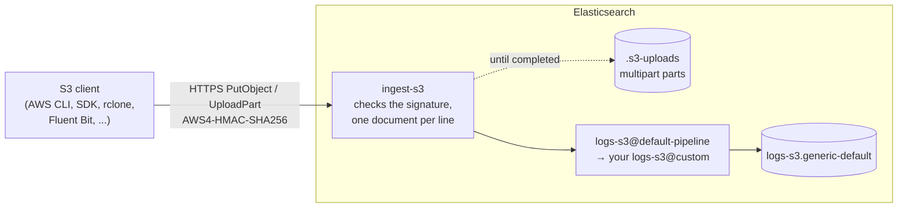

# elastic-ingest-s3

An Elasticsearch plugin that looks like an **S3 bucket**. Anything that can upload files to S3 (the AWS CLI
and SDKs, rclone, Fluent Bit, a log shipper's S3 output) can point at your Elasticsearch endpoint instead:
the plugin checks the AWS signature, reads the object and indexes every line. No file is stored anywhere.

```bash
aws s3 cp app.ndjson.zst s3://logs/app/app.ndjson.zst --endpoint-url https://<elasticsearch-endpoint>
```

* **Uploads:** `PutObject` and multipart uploads, signed with AWS Signature V4 (including the aws-chunked
  bodies and trailing checksums current AWS SDKs send), path-style.
* **Content:** ndjson, plain text lines, or a `.json` file holding one JSON array; gzip, zstd, lz4 or
  uncompressed, recognized from the content.
* **Answer:** `200` only once every line is indexed. Anything else makes the client retry, and a retry
  never duplicates a line.

> **Community project**, not an official Elastic product. Each zip works with exactly one Elasticsearch
> version. Elastic and Elasticsearch are trademarks of Elasticsearch B.V.; Amazon S3 and AWS are trademarks of
> Amazon.com, Inc. or its affiliates.



Retries are safe: each document's `_id` comes from the bucket, key, ETag and line number. Multipart parts can
reach different nodes, so they wait in a system index until the upload completes; uploads never completed are
deleted after `s3.multipart_expiry` (24 hours).

## Install

Download the zip for your Elasticsearch version from [Releases](../../releases/latest).

* **Self-managed:** `bin/elasticsearch-plugin install file:///path/to/ingest-s3-<version>-es<es>.zip` on every node, then a rolling restart.
* **Elastic Cloud:** Extensions → create a *plugin* extension with the zip, then enable it on the deployment.

## Set up

**1. Let S3 requests reach the plugin.** S3 clients sign requests the AWS way, which no Elasticsearch realm
understands. In the user settings or `elasticsearch.yml`:

```yaml
xpack.security.authc.anonymous.username: s3_anonymous
xpack.security.authc.anonymous.roles: s3_anonymous
xpack.security.authc.anonymous.authz_exception: false
```

`s3_anonymous` is built into the plugin and has **no privileges**: every other API still answers 401. Never
create a role with that name yourself. With anonymous access on, Elasticsearch reads a request's whole body
(up to `http.max_content_length`, 100 MB) before refusing it, so **allow only your senders** (Cloud traffic
filters or a firewall).

**2. Give the plugin a key to write with**, and store its `encoded` value in the keystore as `s3.api_key`
(Cloud: Security → Elasticsearch keystore), then `POST _nodes/reload_secure_settings`:

```
POST _security/api_key
{"name":"ingest-s3","role_descriptors":{"writer":{"indices":[{"names":["logs-*-*","metrics-*-*"],"privileges":["create_doc","auto_configure"]}]}}}
```

The key must be able to write every data stream a line can end up in, including any a pipeline reroutes to.
Install the plugin first: Elasticsearch won't start with a keystore entry no plugin knows.

**3. Create access keys for your senders.** Make up an id and a secret:

```bash
echo "AKIA$(openssl rand -hex 8 | tr a-f A-F)"; openssl rand -base64 30
```

```
PUT _cluster/settings
{"persistent":{"s3.access_keys":["web-tier=AKIA0123456789ABCDEF:<secret>"],"s3.buckets":["logs"]}}
```

`web-tier=` is an optional name, recorded as `s3.access_key_name`. Each `PUT` replaces the list; revoke a key by
leaving it out. `s3.buckets` is optional.

**4. Point your senders at it**, path-style, with a read timeout of a few minutes (the answer comes once every
line is indexed):

```ini
# ~/.aws/config
[profile es]
endpoint_url = https://<elasticsearch-endpoint>
s3 =
  addressing_style = path
```

* **rclone:** `--s3-force-path-style --s3-no-check-bucket --s3-no-head` (provider `Other`).
* **Fluent Bit (`s3` output):** leave `compression` unset; compress the file instead. `Content-Encoding: gzip`
  is decoded by Elasticsearch before the plugin sees the body, which breaks the signature.
* **curl:** `curl --aws-sigv4 "aws:amz:us-east-1:s3" --user "$AK:$SK" -H "x-amz-content-sha256: <sha256>" -T app.ndjson https://<elasticsearch-endpoint>/logs/app/app.ndjson`

Not supported: GET, HEAD, LIST, DELETE, creating buckets (nothing is stored), virtual-hosted addressing,
presigned URLs, SigV4a.

## Test it

```bash
ES_URL=https://<elasticsearch-endpoint> ACCESS_KEY=AKIA0123456789ABCDEF SECRET_KEY='<secret>' ./scripts/test-s3.sh
```

```esql
FROM logs-* | WHERE event.module == "s3"
| STATS lines = COUNT(*), last_seen = MAX(event.ingested) BY s3.access_key_name, s3.bucket, agent.type
```

| answer | cause |
|---|---|
| 403 `InvalidAccessKeyId` / `SignatureDoesNotMatch` | access key not in `s3.access_keys`, wrong secret, or a proxy changed `Host` without `X-Forwarded-Host` |
| 400 `XAmzContentSHA256Mismatch` | the client sent `Content-Encoding: gzip` |
| 403 `RequestTimeTooSkewed` | the sender's clock is more than 15 minutes off |
| 404 `NoSuchBucket` | bucket not in `s3.buckets` |
| 503 `SlowDown` | Elasticsearch is busy, or the API key can't write the target; the client retries |
| 401 | the anonymous settings are missing |

## Data streams and parsing

Lines land in `logs-s3.generic-default`, with the line in `message`. `s3.target` changes that: `{bucket}` is the
bucket and `{name}` the value of a `name=value` folder in the key, so with `logs-s3.{service}-default` an upload
to `s3://logs/app/service=cart/x.ndjson` goes to `logs-s3.cart-default`.

The plugin installs an index template for `logs-s3.*-*` (the `logs` settings and mappings, `s3.*` fields, the
failure store) whose default pipeline calls `global@custom`, `logs@custom`, `logs-s3@custom` and
`logs-<dataset>@custom`, each if it exists. Your parsing goes there:

```
PUT _ingest/pipeline/logs-s3@custom
{"processors":[
  {"json":{"field":"message","add_to_root":true,"if":"ctx.message.startsWith('{')"}},
  {"reroute":{"dataset":"s3.cart","if":"ctx._index == 'logs-s3.generic-default' && ctx.message.contains('cart')"}}
]}
```

**Metrics** go through the same pipeline: parse the line, then reroute it to a `metrics-*` stream, where
Elasticsearch's built-in `metrics` template maps numbers as numbers. Say metrics are uploaded to a bucket named
`metrics`:

```
PUT _ingest/pipeline/logs-s3@custom
{"processors":[
  {"json":{"field":"message","add_to_root":true,"if":"ctx.s3?.bucket == 'metrics'"}},
  {"remove":{"field":"message","if":"ctx.s3?.bucket == 'metrics'"}},
  {"reroute":{"destination":"metrics-s3.generic-default","if":"ctx.s3?.bucket == 'metrics'"}}
]}
```

Do all the shaping before the `reroute`: the built-in `metrics` template runs no pipeline of its own.

Keep the `ctx._index` condition on a reroute: a line rerouted to another `logs-s3.*` stream runs
`logs-s3@custom` again there. Keep the failure store on: a line Elasticsearch refuses for good is otherwise
dropped, and the upload still answers `200`.

## Documents

| field | |
|---|---|
| `message` | the line (or JSON array element) exactly as written |
| `@timestamp`, `event.ingested` | when the object was received; a pipeline can set `@timestamp` from the line |
| `agent.type`, `agent.version` | the sender, from the `User-Agent` (`aws-cli`, `2.17.0`) |
| `event.module` | `s3` |
| `s3.bucket`, `.key`, `.etag`, `.line` | the object, and the line's number in it |
| `s3.format`, `.compression` | `lines` or `json_array`; `gzip`, `zstd`, `lz4` or `none` |
| `s3.partition.*` | the key's `name=value` folders |
| `s3.access_key_name`, `.access_key_id` | who uploaded it |
| `s3.request.*` | the upload: `id`, `received`, `node`, `remote_address`, `user_agent`, `bytes` |

An object that can't be read (corrupt, a line over 16 MiB, past 50 million lines or 1 GiB decompressed) keeps
the lines before the problem and adds one document with `error.message`; the upload answers `200` so the client
doesn't resend it forever.

## Settings

| setting | default | |
|---|---|---|
| `s3.access_keys` | — | `[name=]ACCESS_KEY_ID:SECRET`; never shown by `GET` |
| `s3.buckets` | any | accepted bucket names |
| `s3.target` | `logs-s3.generic-default` | data stream; `{bucket}` and `{<key partition>}` placeholders |
| `s3.templates.enabled` | `true` | `false`: manage the `logs-s3.*-*` template yourself |
| `s3.metadata` | `full` | `minimal`: only `s3.bucket`, `.key`, `.line`, `.access_key_name`, `agent.*`, `event.module`; 25–38% faster |
| `s3.retry_delay` | `10s` | how long a 503/500, or a wrong signature for a known key, is held back |
| `s3.multipart_expiry` | `24h` | uploads neither completed nor aborted are deleted after this |
| `s3.api_key` | — | keystore; the identity lines are written with |

All but the keystore entry are cluster settings: change one at any time, no restart.

## Performance

200,000 JSON log lines (160 bytes each) as 40 objects or requests of 5,000 lines, one Elasticsearch 9.5.4 node
(4 GB heap, 8 cores), median of 5 runs ([`scripts/benchmark.sh`](scripts/benchmark.sh)):

| path | sent | 1 at a time | 8 parallel |
|---|---|---|---|
| plugin, `zstd`, `s3.metadata: minimal` | 5.6 MB | 32,900 lines/s | 140,700 |
| plugin, `zstd` | 5.6 MB | 25,300 | 112,600 |
| `_bulk`, gzip, the same documents | 11.3 MB | 27,000 | 125,700 |

With the same documents the plugin is 85–94% as fast as `_bulk`, and sends half the bytes.

## Build

```bash
./build-plugin.sh                     # Elasticsearch 9.5.4 -> dist/ (Docker only; runs the tests)
ES_VERSION=9.5.5 ./build-plugin.sh
```
